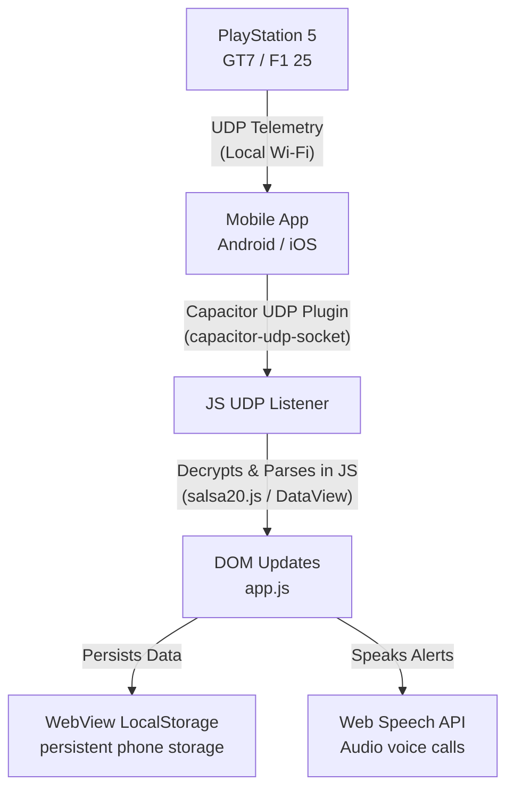

# Implementation Plan: Standalone Android & iOS Mobile App Migration

We will convert the Race Engineer Dashboard from a PC-hosted web application into a standalone native mobile application for **Android** and **iOS** using **Capacitor**. 

This migration will eliminate the need for a separate PC python server (`server.py`). The mobile app itself will run on the phone or tablet, connect directly to the local Wi-Fi network, capture the UDP telemetry packets from the PS5, decrypt/parse them in JavaScript, update the UI, and store settings and race history on the device's persistent storage.

---

## Technical Architecture

1. **Capacitor Integration**: We will initialize a Capacitor project wrapping our static asset directory (`static/`). This lets us run our premium dark glassmorphic styling, neon animations, Chart.js plots, and Web Speech AI voice engine directly on both Android and iOS without rewriting the UI code.
2. **Device UDP Sockets**: We will use the `@capacitor-community/udp-socket` plugin to bind local UDP port `20777` (F1 25) and `33740` (GT7) directly on the mobile OS.
3. **JS-based Salsa20 Decryptor**: We will implement a lightweight, pure JavaScript Salsa20 decryption module to decrypt GT7's telemetry stream on-device.
4. **JS-based Binary Parser**: We will implement a packet reader using JavaScript's native `DataView` to parse packed structs for F1 25 and decrypted buffers for GT7.
5. **Local Storage**: Race settings and history logs will use the WebView's persistent `localStorage` APIs, which run natively on mobile devices.

---

## User Review Required

> [!IMPORTANT]
> **Local Network Permission (iOS & Android)**:
> - **On iOS**: The app will request **Local Network** permissions when it first tries to bind to the UDP sockets. The user must approve this permission, otherwise, the app will not receive telemetry packets from the PS5.
> - **On Android**: We will add the required internet and access network state permissions to the `AndroidManifest.xml` file.
> - Both the mobile device and the PS5 **must be on the exact same Wi-Fi router** (and subnet) for UDP broadcast/multicast packets to be routed.

---

## Proposed Changes

### Mobile Project Configuration

#### [NEW] [package.json](file:///c:/AntiGravity-PS5/package.json)
Creates the Node.js project manifest and lists dependencies:
- `@capacitor/core` and `@capacitor/cli`
- `@capacitor/android` (Android native support)
- `@capacitor/ios` (iOS native support)
- `capacitor-udp-socket` (Native UDP socket bridge)

#### [NEW] [capacitor.config.json](file:///c:/AntiGravity-PS5/capacitor.config.json)
Configures Capacitor web assets to point to our `./static` directory and names the app bundle (e.g. `com.apexengineer.dashboard`).

---

### Dashboard Core Refactoring

#### [NEW] [salsa20.js](file:///c:/AntiGravity-PS5/static/salsa20.js)
A pure JavaScript implementation of the **Salsa20** stream cipher to decrypt GT7 telemetry packet streams on-device.

#### [MODIFY] [index.html](file:///c:/AntiGravity-PS5/static/index.html)
- Include `` to expose Salsa20 decryption.
- Include `` (built dynamically by Capacitor during compilation) to expose native Capacitor bridge capabilities.

#### [MODIFY] [app.js](file:///c:/AntiGravity-PS5/static/app.js)
- Replace the WebSocket connection flow (`socket = new WebSocket(wsUrl)`) with Capacitor UDP socket bind commands.
- Implement [F1 25 Packet Session/Lap/Telemetry parser](file:///c:/AntiGravity-PS5/static/app.js) using JS `DataView` to unpack coordinates, gears, speeds, tyre variables, and weather splits.
- Implement [GT7 Packet parser](file:///c:/AntiGravity-PS5/static/app.js) that decrypts incoming datagrams using `salsa20.js` and unpacks the variables.
- Maintain fallback simulation/mock mode so users can test layouts and the Virtual Engineer speech assistant offline.

---

## Verification Plan

### Automated/Simulation Tests
- We will add local mock tests in [test_telemetry.py](file:///c:/AntiGravity-PS5/scratch/test_telemetry.py) or test the JavaScript parsers directly in the browser console.

### Manual Verification
- Compile and run the application on:
  1. An Android Emulator or connected Android phone using `npx cap run android`.
  2. An iOS Simulator or connected iPad/iPhone using Xcode via `npx cap run ios`.
- Set the game settings to `mock` and verify the simulation maps telemetry, lights, charts, and voice engineering.
- Connect to a live PS5 on the local Wi-Fi and verify real-time telemetry updates.
